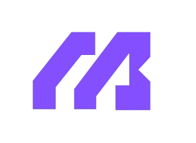

<p align="center">
  
</p>

<h1 align="center">MeuBolso</h1>

<p align="center">
  Controle financeiro pessoal, simples e 100% offline.
</p>

<p align="center">
  <a href="https://flutter.dev"></a>
  <a href="https://dart.dev"></a>
  <a href="https://sqlite.org"></a>
  
  
  
</p>

---

## Sobre o projeto

**MeuBolso** é um aplicativo móvel de controle financeiro pessoal desenvolvido em Flutter. Todo o processamento e o armazenamento acontecem no dispositivo: não há back-end, conta online ou dependência de internet. O usuário cadastra um perfil local protegido por senha e passa a registrar receitas e despesas, acompanhar o saldo mensal, visualizar gráficos e consultar relatórios.

O projeto segue **Clean Architecture (Feature-First)**, com as camadas de Domínio, Dados e Apresentação bem delimitadas, injeção de dependências explícita por construtores e desenvolvimento guiado por especificações (`.spec/`).

## Funcionalidades

| Módulo | Descrição |
| --- | --- |
| **Autenticação local (T01)** | Cadastro de perfil único por instalação, login por senha e logout com confirmação. A senha nunca é armazenada em texto limpo. |
| **Dashboard (T02)** | Saldo disponível, total de receitas e despesas do mês, variação percentual em relação ao mês anterior, gráfico comparativo e as 5 últimas movimentações. |
| **Transações (T03)** | Listagem de receitas e despesas, filtros por mês, tipo e modalidade, edição, exclusão lógica e restauração. |
| **Formulários (T04)** | Cadastro e edição de receitas e despesas com validação de descrição, valor, categoria e data. |
| **Categorias dinâmicas** | Categorias padrão pré-carregadas e criação de novos tipos pela interface, sem duplicidade de nome por tipo. |
| **Relatórios (T05)** | Totais do período, gastos por categoria com percentual e evolução mensal de receitas e despesas. |
| **Tema claro/escuro** | Suporte a `ThemeMode.system`, claro e escuro, com paleta semântica Material 3 e tipografia Plus Jakarta Sans. |

## Stack tecnológica

| Camada | Tecnologia |
| --- | --- |
| Aplicativo | [Flutter](https://flutter.dev) / [Dart](https://dart.dev) |
| Persistência transacional | [sqflite](https://pub.dev/packages/sqflite) (SQLite) |
| Dados sensíveis | [flutter_secure_storage](https://pub.dev/packages/flutter_secure_storage) |
| Imutabilidade e serialização | [freezed](https://pub.dev/packages/freezed) + [json_serializable](https://pub.dev/packages/json_serializable) |
| Gráficos | [fl_chart](https://pub.dev/packages/fl_chart) |
| Formatação e i18n | [intl](https://pub.dev/packages/intl) e `flutter_localizations` (`pt_BR`) |
| Criptografia | [crypto](https://pub.dev/packages/crypto) (SHA-256 com salt) |
| Ícone nativo | [flutter_launcher_icons](https://pub.dev/packages/flutter_launcher_icons) |

## Arquitetura

O código é organizado por funcionalidade (`feature-first`) e cada feature replica as três camadas da Clean Architecture:

```text
Apresentação  →  Controlador  →  Caso de uso  →  Contrato de repositório
                                                        │
                                                        ▼
                                              Implementação do repositório
                                                        │
                                                        ▼
                                             Data Source (SQLite / Storage)
```

- **Domain** — entidades puras (`freezed`), casos de uso, contratos de repositório e falhas de negócio. Não conhece Flutter, banco ou UI.
- **Data** — implementações de repositório, data sources e DTOs, com mapeamento explícito entre modelo e entidade.
- **Presentation** — páginas, widgets e controladores (`ChangeNotifier`). Estados reativos simples, sem bibliotecas externas de gerenciamento de estado.
- **Injeção de dependências** — composição explícita em `main.dart`, agregada em `DependenciasApp` e entregue por construtor ao `MeuBolsoApp`. Não há service locator global.

### Estrutura de diretórios

```text
lib/
├── main.dart                  # Composição das dependências e inicialização
├── app.dart                   # MaterialApp, rotas, temas e controladores
├── dependencias_app.dart      # Agregado de casos de uso
├── core/
│   ├── database/              # Acesso ao SQLite, esquema e migrações
│   ├── domain/                # Enums compartilhados
│   ├── navegacao/             # Rotas nomeadas
│   ├── theme/                 # Cores, tipografia e ThemeData
│   ├── utils/                 # Formatação de moeda e ícones
│   └── widgets/               # Componentes reutilizáveis
└── features/
    ├── autenticacao/          # Perfil local, login e logout
    ├── categorias/            # Categorias padrão e customizadas
    ├── dashboard/             # Agregações e painel inicial
    ├── transacoes/            # Receitas e despesas
    ├── relatorios/            # Totais, categorias e evolução mensal
    └── financas/              # Páginas e widgets do fluxo financeiro
```

## Modelo de dados

O banco `meu_bolso.db` é criado e migrado em `core/database/` (versão atual: **2**).

| Tabela | Responsabilidade |
| --- | --- |
| `perfis` | Perfil local (nome, e-mail, salt e data de criação). |
| `categorias` | Categorias de receita e despesa, com flag `is_padrao` e unicidade por `(nome, tipo)`. |
| `transacoes` | Receitas e despesas, com valor em centavos, competência, modalidade e exclusão lógica. |
| `recorrencias` | Configuração de recorrências mensais (schema preparado para a evolução do produto). |

Os dados sensíveis de autenticação (perfil serializado e verificador de senha) ficam no `flutter_secure_storage`, separados do banco relacional.

### Regras de negócio centrais

- **Valores monetários em centavos** — todo valor trafega e é persistido como `int` (`valor_centavos`). A conversão para `R$` ocorre apenas na apresentação, via `intl`.
- **Exclusão lógica** — transações nunca são removidas fisicamente; o campo `excluida_em` é preenchido e todas as consultas ignoram registros excluídos.
- **Credenciais protegidas** — a senha em texto limpo não é persistida. O app gera um `salt` aleatório e armazena apenas o hash SHA-256 no armazenamento seguro.
- **Competência mensal** — cada transação pertence a uma competência no formato `AAAA-MM`, indexada para consultas e agregações rápidas.
- **Categorias padrão** — a inicialização do banco insere categorias padrão de receita e despesa de forma idempotente.

## Como executar

### Pré-requisitos

- [Flutter SDK](https://docs.flutter.dev/get-started/install) estável (Dart 3.8+)
- Android Studio com SDK Android **ou** Xcode com CocoaPods (para iOS)
- Dispositivo/emulador configurado

### Instalação

```bash
# Clone o repositório e acesse a pasta
git clone <url-do-repositorio>
cd MeuBolso

# Instale as dependências
flutter pub get

# Gere os arquivos do freezed/json_serializable
dart run build_runner build --delete-conflicting-outputs

# Execute o aplicativo
flutter run
```

> Em ambientes onde o comando `dart` não resolve o SDK do Flutter, use `flutter pub run build_runner build --delete-conflicting-outputs`.

### Build de produção

```bash
flutter build apk --release      # Android
flutter build appbundle --release
flutter build ios --release      # iOS (requer macOS/Xcode)
```

### Nome e ícone

O nome de exibição é **Meu Bolso** nas plataformas nativas. O ícone é gerado a partir de `assets/icons/app_icon.png`:

```bash
flutter pub run flutter_launcher_icons
```

## Testes e qualidade

```bash
flutter analyze     # Análise estática (flutter_lints)
flutter test        # Testes unitários e de widget
```

A suíte cobre entidades e modelos, casos de uso, repositórios, controladores e fluxos de interface. Atualmente são **87 testes**, todos passando, distribuídos em:

```text
test/
├── features/
│   ├── autenticacao/   # Repositório, controlador e tela T01
│   ├── categorias/     # Modelo, repositório, casos de uso e widgets
│   ├── dashboard/      # Repositório e agregações
│   ├── financas/       # Fluxo de despesas e controlador financeiro
│   ├── relatorios/     # Repositório, casos de uso e controlador
│   └── transacoes/     # Modelo, casos de uso e controlador
├── helpers/            # Fakes compartilhados
└── widget_test.dart    # Integração da árvore principal do app
```

## Padrões do projeto

- **Idioma do código:** identificadores, comentários e mensagens em português (`pt_BR`); apenas termos do framework e de APIs permanecem em inglês.
- **Commits:** mensagens no infinitivo, curtas e descritivas, no padrão Conventional Commits — por exemplo, `feat(autenticacao): implementar logout e botao sair na tela inicial`.
- **Especificações:** o desenvolvimento segue o fluxo **SDD (Spec-Driven Development)**. Cada funcionalidade possui um documento em `.spec/features/`, e ajustes pontuais ficam em `.spec/adjustments/`.

### Estrutura de especificações

```text
.spec/
├── constituition.md           # Diretrizes arquiteturais e regras do projeto
├── contexto_geral.md          # Visão geral, stack e funcionalidades
├── features/                  # Especificações por funcionalidade
└── adjustments/               # Especificações de ajustes pontuais
```

Antes de implementar uma mudança estrutural, consulte a especificação correspondente e mantenha o código alinhado a ela.

## Roadmap

- [x] Autenticação local com perfil único e logout
- [x] Dashboard com agregações mensais e comparativos
- [x] CRUD de receitas e despesas com exclusão lógica
- [x] Categorias dinâmicas persistidas no SQLite
- [x] Relatórios de totais, categorias e evolução mensal
- [x] Tema claro/escuro e identidade visual nativa
- [ ] Rotina automática de recorrência de salário
- [ ] Exportação de dados e backups locais

## Referência visual

As telas de referência do produto estão disponíveis em [`telas do sistema.pdf`](telas%20do%20sistema.pdf).
